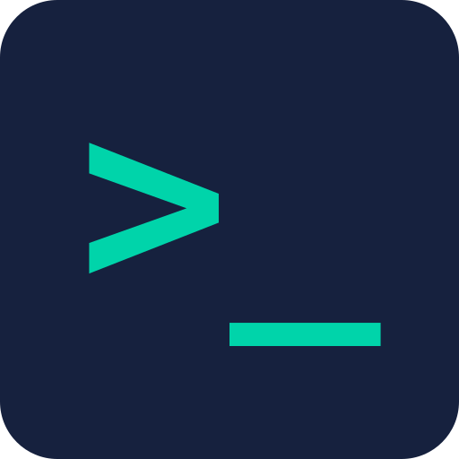

<p align="center">
  
</p>

<h1 align="center">Web Terminal</h1>

<p align="center">
  <b>Your AI coding agents, running on your Windows machine — reachable from any browser or your phone.</b>
</p>

<p align="center">
  
  
  
</p>

---

Start a Claude Code session on your desktop, walk away, and approve its next step from your
phone. Web Terminal keeps the shells alive on the host and gives you a real terminal —
plus a readable chat view of what the agent is actually doing — from anywhere on your
private network.

```bash
git clone https://github.com/Adiel-Sharabi/web-terminal.git
cd web-terminal && npm install && npm start
```

Open **http://localhost:7681** — default login `admin` / `admin`, which it makes you change.
Full instructions: **[docs/INSTALL.md](docs/INSTALL.md)**.

## Why

- **It doesn't stop when you close the tab.** A dedicated worker process owns every PTY, so
  sessions survive server restarts, browser reloads and network drops — with scrollback intact.
- **You find out when it needs you.** Permission prompts raise an urgent alert and can push
  to your phone even with the app closed. No more discovering a blocked agent an hour later.
- **It reads like a conversation, not a screen scrape.** The companion app renders the
  agent's transcript as chat, with proper cards for shell commands, file edits and subagents.
  When the agent asks you a question, the card offers what the terminal's selector does:
  the options, free text (on a multi-select question too, alongside the ticks), and *Chat
  about this* to talk the question over instead of answering it. The server types the
  answer (`POST /api/sessions/:id/answer`, the keys and the gaps between them), so a phone
  that pauses or reconnects halfway through an answer no longer loses its last keys.
- **It waits out the 5-hour cap for you.** When an agent hits its usage limit it blocks on a
  question ("stop and wait, or upgrade?"). The worker answers *wait*, the row shows when the
  window reopens, and the session picks itself back up a minute after it does — so a limit
  hit overnight costs you the window, not the morning. Only sessions actually observed to be
  capped are resumed, and any row's badge turns it off for that session.
- **One sidebar, every machine.** Run it on several boxes and drive them all from one list.
- **Private by construction.** It binds to localhost; you reach it over your own VPN. Push
  notifications are content-free wake-ups — the text is fetched from your server, not a relay.

## Agent support — read this before choosing

| | Claude Code | Codex |
|---|:---:|:---:|
| Sessions, terminal, chat view, task list, usage badges | ✅ | ✅ |
| Status: waiting / idle | ✅ | ✅ |
| Status: **working** | ✅ | ❌ |
| Subagent drill-in · background-work badge · compaction indicator | ✅ | ❌ |

**Claude Code is fully supported. Codex support is partial and honest about it** — sessions
run and are genuinely usable, but Codex's hooks do not execute (measured, not assumed), so
status rides a narrower channel that has no turn-start signal. A Codex session can never
show *working*. Details and the reasoning: **[docs/AI-AGENTS.md](docs/AI-AGENTS.md)**.

Any other CLI runs fine as a plain shell — it just gets no agent-specific features.

## Highlights

**Sessions** — multiple terminals, instant switching, persistence across restarts, lazy
scrollback, drag-to-reorder, server-side favourites shared by every client (starred from
the session list or from the open session itself), and a one-click recap answering
*"where was I in this one?"*

**Agent integration** — live status dots, task-list panel, rich tool cards, subagent
drill-in, context-window and rate-limit badges, background-work indicator, and read-aloud
that filters out the parts nobody wants spoken.

**Inbox digest** — a waiting session's whole turn is often pages long, so the inbox can ask the
server for a short, model-written briefing of one wait: what the session is about, what exactly
is being asked, and what you need to know to answer (`GET /api/sessions/:id/digest`, advertised
as the `inbox-digest` capability). It is context only: the real question and its options stay
the authority, and nothing it says answers or changes anything. A run happens only when a client
asks (never on a poll), is cached per wait, and is shared by concurrent askers; at most two run
at once. It calls your own `claude -p` login with every tool and setting switched off, from a
scratch folder, and writes in the language of your last prompt. Configure it with an
`inboxDigest` block in `config.json` — `enabled` (default true), `model` (default `sonnet`) and
`command` (the CLI, as a path or `[path, ...args]`; default: `claude.exe` on `PATH`, then
`~/.local/bin`). It is read live and is **not** settable over HTTP, because `command` is
something the server runs.

**Inbox card menu** — right-click a card in the companion's questions inbox (long-press on a
phone or tablet) for what fits that card: **Not a question** for a reply misread as asking,
**Not waiting** for a reported wait, plus **Open session** and **Copy text**. Nothing in it
answers, rejects or types into the session, and a real question, a permission prompt or a
background agent cannot be dismissed at all (a background agent leaves the inbox by itself once
it stops waiting), so the inbox's count stays the board's Needs-you count. A dismissed ask
moves to a collapsed **Dismissed** list with Restore (and Undo right after), and comes back by
itself when the session asks something new. Dismissals are kept with the session on its own
server (`PATCH /api/sessions/:id/brief` with `inboxDismiss`, the brief's `inboxDismissed`,
advertised as `inbox-dismiss`), so every device hides the same asks and they survive restarts;
against an older server they hold on that device only, until the app restarts.

**Mobile & PWA** — installable, with a compose bar built for soft keyboards, a touch
toolbar, long-press menus, and reconnect the instant you return to the app. When a phone
and a desktop watch the same session, the shared terminal is sized to fit the **smaller**
of them, so a full-width agent screen never arrives on the phone already wrapped — and
backgrounding the phone hands the columns straight back.

**Slash commands from a button** — `/compact`, `/context`, `/usage` and `/clear` are one
tap in either client, instead of a command typed in full into an agent's TUI on a phone.
The button row is **published by the server**, so which commands appear, what they are
called and in what order is one table (`lib/commands.js`) rather than a copy in each
client. Running one lands you where its result actually is: `/compact` stays in the chat
lens with its progress indicator, while `/clear` and the TUI-only panels hold the terminal
lens until you have read them. `/clear` asks first and sorts last — on a phone the first
button is the one a thumb reaches by accident — and no button can fire into an agent that
is still starting.

**Nor can a prompt, in either client.** A new session hands you a compose bar seconds
before its agent has booted, and anything sent in that window reaches the *shell* instead:
it runs as a command, or does nothing, and is gone with no error anywhere. Both the submit
and the live `/`-line now wait for the agent to actually be up — the second matters as much
as the first, because that path streams to the terminal *as you type*, so half a slash
command can end up on bash's command line with the launch command typed onto the same line
after it. Typing is never blocked and your draft is never cleared; the bar says why nothing
was sent, and you press Send again once the agent is up. It is deliberately **not** sent
for you — firing a sentence somebody was still editing is its own way to lose their words.

**A swallowed prompt says so, and gives the words back** — submit while the agent's TUI
is somewhere other than its composer (a full-screen `/usage` view, an open slash menu, a
crashed CLI back at the shell) and the keystrokes are eaten as navigation; until now your
words simply vanished with no error anywhere. The server does not guess at that state
(measured: none of those views emits a distinguishing byte). It **verifies the outcome
instead** — a compose-bar submit that produces no sign of life from the agent is
reported, and the client puts your text back, but only into a compose bar you have not
already started retyping into. Claude sessions on a server whose hooks are installed;
every gate errs toward saying nothing, because a false alarm on a prompt that did land
would be worse than the silence it replaces.

**And a session that is stuck behind a question says which question** — open a session
in a folder Claude has not been trusted with and it parks on a selector before its
composer ever exists. Nothing about that session looks unusual, so you type a prompt and
send it: the keystrokes are taken as navigation and the trailing Enter confirms the
highlighted row, which is **`No, exit`** — the agent is not merely deaf, it is gone, and
your next prompt lands in the shell. The server now recognises that screen by its
*shape* rather than its wording (an unnumbered list with a cursor, a sibling option and
`Enter to confirm`), so siblings like the external-`CLAUDE.md` imports prompt are covered
too. Such a session is never published as able to take a prompt, and the compose bar
stops claiming it is "starting": it quotes the dialog's own options back to you and
points at the Terminal lens. Your draft stays in the box, because nothing was ever sent.
Answering it — or any hook from the agent — clears the block on its own.
Typing the answer *for* you is a separate, opt-in setting
(`autoAnswerBlockingPrompt`, **off** by default: trusting a folder is what decides
whether an agent may execute what is in it). Turned on, it answers yes to folder trust
and to the external-`CLAUDE.md` imports prompt, one key at a time: it waits for the
screen to settle, and confirms only when the screen shows the highlight on the yes
row, so a dialog that resets its highlight while the agent is still starting up is
never confirmed on `No, exit` (#430).

**Sessions dashboard** — the ▦ button (in the companion app, the dashboard icon on the
Sessions screen) opens every session on every server at once: the
work item(s) each one is on and their state, what it is doing right now, what it just
finished, and what you last asked it, with a **Needs you** strip on top. It is built to
be **true**, not merely filled in: what the hooks prove (the current tool, the last
turn's summary, a commit or a `gh issue close` that touched an item) is shown as fact,
the agent reports only what only it knows (which item, which state), every Claude
session is told how on every prompt, and a turn that changed an item without reporting
it is held for one short report before it ends. A report that has fallen behind says
so on its card. Pin a work item yourself, or switch reporting off for one session.
Every **claude.ai artifact** a session published (an overview page, a plan, a report) is
a link on its card, newest first, and on the closed-sessions list for a week after it ends. It is read
from the publish itself rather than reported, artifacts published before this shipped are
picked up from the session's transcript, and the filter finds a session by an artifact's
title.

A collapsible **Machines** section answers *which machine should I open a new session on?*
For each server it shows its sessions against the soft session limit (and how many are working
or waiting), CPU load and cores, free memory, free **virtual memory** (commit, which can run
out before memory does), free space on each fixed drive, and uptime. A reading that is low
is amber or red, decided by the server (`lib/machine-profile.js`) so both clients agree. The
drive and virtual-memory figures cost the server a CIM query, so they are read only while
the section is open (`GET /api/machine`, cached for a minute); whether it is open is
remembered per device.

A collapsible **Leases** section shows every cluster resource lease (below): for each resource,
who holds it (the session and its machine, for how long, until when) and who waits behind it in
order, with a tap through to the holder's session. Its title carries the counts, so it tells
even closed. A session's own card says what it holds, or what it is waiting for, its place in
line and who holds it. The table is read every 10 seconds from one server that advertises
`leases` (a server does so only when `leases.authority` is configured; each forwards to the
lease authority); when the authority cannot be reached the
section says the table is unknown, and the cards say nothing, rather than show an empty or old
table. Display only: release stays with the holder.

The session limit is **soft** (`maxSessions`, default 10): a machine never refuses a new
session for the count. The **New session** sheet shows how many sessions the chosen machine
already runs, amber at the limit and red past it.

**Background agents** — the agents Claude runs in the background (`claude agents --json`) are listed machine-wide on the server (`GET /api/dashboard/background-agents`): name, project folder, state and what a blocked one is waiting on. Read-only, fetched only when asked and cached for 30 seconds, and a machine without a recent `claude` simply reports it as unavailable.

It is a place to work FROM: your **Favorites** lead it; sessions group by **why they are not
working** (needs you, including a session stuck in a menu, working, running on its own,
blocked on others, idle, done), by server or
by work item; filter by text or machine and choose the order; and **hide** a session that is
not relevant (with an undo) into a Hidden tab, stored on its server so every device agrees.

In the **companion app** the dashboard is a **session board** you can act from: three columns
(**Needs you**, **Working**, **Idle / done**), and on a wide window it fills the main area whenever
no session is open. A question card answers with one press per option, a session waiting on you
takes a one-line reply, **Stop** interrupts a working session, a session stuck in a menu gets Esc,
and **Not waiting** clears a reported wait. **Closed in the last days** keeps a week of closed
sessions, grouped by day, and **Reopen** starts a new session that resumes that conversation on
the same server.

**Why a session is idle** — the session list and the dashboard say why a session that is not
working is not working: it is waiting on you, it will carry on by itself (a CI run, a build, a
usage cap, with how long), it is blocked on someone else, or it is done. Hard signals come
first; what the agent reports at the end of its turn fills in the rest. When an agent
reports it is waiting on you and it is not, **Not waiting** (in the card's menu, beside its
entry in the Needs you strip, where a hidden session shows, or on its row in the session list)
clears it. The session list also has a **filter by title** box.

**Hand off a long session** — a Claude session that has run for days re-reads its whole
context on every turn, and past ~700k tokens it starts losing track of what it already read.
When one is idle, its own report says it is waiting on someone else or done, and its context
has passed the session's hand-off point (below), the companion's board offers **Hand off** on its row. One press makes
the session update its tracker and write a brief for its successor (it posts no GitHub
comment), says whether closing it would lose anything, then starts a fresh session in the same
folder from that brief. The old session closes only once the new one has actually started a
turn and nothing would be lost; otherwise it stays open and the row says why. Every failure
leaves it as it was, and **Cancel** works at every step until the moment it closes. The brief is
written outside the session's folder, so a session that asks before writing files will ask once.

**It also happens on its own.** About once a minute the server hands off, one at a time, any
session the board would offer it for, with no press. The successor is named like the old
session with a number after it, `name (2)`. A **Cancel** or **Dismiss**, or an attempt that ended
kept or failed, stops it trying that session again until you type into it. Every start and every
outcome (closed, kept, failed, cancelled) is appended to `handoffs/handoff-log.jsonl`, with who
started it, the context size, the verdict and the successor, so the automatic hand-offs can be
judged afterwards. The briefs are kept for a week.

Tune it with a `handoff` block in `config.json` (`ctxThreshold`, default: the session's
context budget; `idleMin`, default 10; `staleSelfMin`, default 30: a reported "wake myself" wait with nothing running that could wake it (a background command, async subagent, Monitor, pending wake-up or cron job, or a live child session, #443) is stale after that long idle, so the hand-off takes it; `auto: false` to go back to the button only;
`enabled: false` for neither), read live. Claude only: another agent is offered nothing.

**Check-in on an idle session (#443, #458, #461)** — a session that said it would resume on its own
(`wait: self`) can lose whatever was meant to wake it: a watcher killed by a restart, a timer
cut off by a compaction, a report another session never posts. Once such a session has been
stale (nothing alive that could wake it, see `staleSelfMin` above) for another half hour,
web-terminal types **one** short, tagged question into it: are you finished (report wait
`done`), or was a watcher lost (pick the work back up), or do you need the owner (report wait
`you`)? The answer is the wait the session reports, not its prose. The session list and the
dashboard show it: "Checked in 14:02 → done", "→ resumed", "→ needs you", or "→ still nothing
running" when it reported self again with nothing to wake it. Its answer often starts a fresh
watcher, and that one can miss its event too, so a session that answered self or external (or
reported nothing while work is still listed as running) is asked again once it has been idle
`repeatMin` (default 60) minutes since that
answer, then twice that, then four times (1 h, 2 h, 4 h), at most `maxPerPeriod` (default 4)
times per idle period (#463). A session that answered "you" or "done", or pressed Esc, is not
asked again until it has been active again. Never typed into a session that is
working, compacting, booting, capped or armed to auto-resume, in a menu, asking you a question,
waiting on you or reported done, showing an API error (until it has stood an hour over the turn it cut, below), being handed off (or handed off and not
active since), under a restart hold, or that someone typed into in the last 10 minutes
(counted from the server's start after a reload); never when its transcript cannot be read,
because "nothing running" must be a reading, not a failed read; Claude only. The chat lens shows it as a **Check-in** system turn,
never as "You". Every check-in and every answer is appended to `handoffs/check-in-log.jsonl`.
On by default: a `checkIn` block in `config.json` turns it off fleet-wide (`enabled: false`) or
tunes it (`afterMin`, default 30: minutes after the session became stale, so 60 min idle with
the default `staleSelfMin`; `everyMs`, default 60000: at most one check-in per scan), and
`PATCH /api/sessions/:id/brief` with `{"checkInOff": true}` turns it off for one session.
Two more cases are asked even though something is still listed as running (#456), each in its own
words: a lead whose child sessions have **all** stopped (finished, or waiting on someone - often
on it), once the last of them and the lead have been idle 60 min, whatever its own watchers say;
and, as a backstop, any reported self-wait idle `withLiveWorkMin` (default 60) minutes, because
a running watcher is not proof it will ever fire. So every reported self-wait is asked at an idle
hour, and raising `afterMin` alone delays nothing: raise `withLiveWorkMin` with it. A session that reported waiting on someone or something else (`external`: CI, a PR, another
session) is asked too once idle `externalMin` (default 60) minutes (#458): what it waited for may
have come without waking it; if it is still pending it reports `external` again, and one that
reports nothing keeps its standing wait ("→ blocked on others"). A wait on you
and a session that reported done are never asked. The log line records which case asked (`why`).
A turn cut short by an API error (#461) reports no wait at all. Network failures such as
"Connection lost mid-response" or "Can't reach the API server" now count as transient, so once
Claude goes idle on the turn the error cut (about a minute later), the worker types `continue`.
It never types for an error line that only appeared on screen in a turn that then finished, or
after you pressed Esc, and it gives up after continue, continue, /compact until a turn succeeds.
If that gives up, or the error is one it never retries, the session is asked once its error has
stood `apiErrorMin` (default 60) minutes, in its own words: what failed, and to pick the work
back up if it is unfinished. It is asked once per run of failed turns, never hourly.
A session whose wait was cleared without a new one (you or another session typed a follow-up,
and its reply reported nothing) is asked too if reporting is on for it, it has reported before,
and work is still listed as running after `withLiveWorkMin` (#463), in words that say it reported
no wait. Why a session was NOT asked is in `handoffs/check-in-skips.jsonl`: the gate that refused
it (typing, cannot tell, a menu, ...), one line per session when the reason changes and the same
reason at most every 15 minutes; "no reading yet" is not logged.

**An unsent draft holds the server's prompts (#479)** — the server never types its own prompt
(a check-in, a hand-off, the restart hold's question, a supervisor wake or close-out) into a
session whose input box holds text a person typed and did not send: the prompt's Enter would send
their words with it. It reads what is left in the box from the keys it forwards (Enter sends,
Ctrl-C at an idle prompt clears, Backspace and the line-edit keys are followed; history and
anything it cannot follow count as a draft). The prompt is deferred and retried (the restart hold's "back" notice only until its timeout),
and the refusal is logged as `draft`; a supervisor close is refused too. A draft nobody has typed
into for the check-in's quiet period rides the session row as `composerDraft` (for clients) and
shows under the Journal's **Needs you** (`release` says how it ends): send it, or clear it (Ctrl-C at the idle prompt), and the session is reachable again. Esc Esc (or
`/rewind`) opens Claude's Rewind picker, which can put an old prompt back in the box, and an Enter
the server cannot see land (a slash command, a key it does not follow, a recalled prompt) may not
have emptied it: in those cases Ctrl-C does not release it (`release: "send"`), and the session stays held until Claude next reports a prompt sent.
A plain shell (no agent with a composer) is not followed.

**The supervisor, phase 1: facts and the journal (#466)** — the first part of a cluster-wide
supervisor ([docs/SUPERVISOR-DESIGN.md](docs/SUPERVISOR-DESIGN.md)). It is **read-only**: it
takes no action on any session yet.
- A reported wait can name what it waits on, so it can later be looked up: `"target"` is one of
  `session` (`id`), `lead` (the session that opened this one), `pr` and `ci` (`provider`
  github or ado, `repo`, and `number`, `pr` or `runId`), `workitem` (`ref`), `time`
  (`until`, ISO) or `child` (`ids`); `"checkBy"` gives the minutes until it is overdue. A wrong
  shape is refused with the right one; a wait with no target works as before.
- `POST /api/sessions` takes an optional `goal` (one line, up to 300 characters). A hand-off
  successor inherits it.
- Every server appends its sessions' lifecycle (opened, hand-off, closed and why: closed, reaped,
  handed-off, exited, lost) to `logs/sessions-journal.jsonl` and serves it at `GET /api/journal?since=`.
- `POST /api/sessions/:id/prompt {text}` types one `[web-terminal supervisor]` prompt, only when the
  gates the check-in and the restart hold use all allow it (idle, ready, no menu or blocked
  prompt, no restart hold or hand-off, nobody typing); otherwise it answers `refused` with why.
- On the lease authority (`leases.authority`) only, every server is polled each minute into one
  work graph (`GET /api/supervisor/state`: sessions, leads and children through hand-offs, Needs you,
  Live, Ready to close, History). A session whose lead is gone from **every** server, on two scans at
  least 5 minutes apart with every server answering, is marked an orphan; a server that does not
  answer makes it "unknown", never an orphan. Changes are logged to `handoffs/supervisor-log.jsonl`.
  Config `supervisor`: `enabled` (default true), `exclude` (server names left out entirely),
  `everySec` (default 60).

**The supervisor, phase 2: wake on fact and reach the owner (#467)** — the supervisor now acts,
only on what can be undone, and only through the gated prompt of the session's own server.
- **Wake on fact (R1).** Every targeted wait is looked up each scan: `session`, `lead`, `child`
  and `time` from the cluster graph; `pr`, `ci` and `workitem` through the `gh` login and the ADO
  REST API (`ADO_PAT`, read from the User environment and never logged; `supervisor.ado.org` and
  `.project` say where ADO targets live). The answer is pending, resolved, gone or unknown, and
  **unknown never acts**. A resolved or gone target wakes its session **once per wait** with
  `[web-terminal supervisor] Your wait "<what>" changed: <fact>. Carry on, or report a new wait.`
  The prompt names the wait it answers (`expectWaitAt`), so a session that reported again since is
  refused `stale`. A bare `#123` target is qualified with the reporting repo when it is reported.
- **Tell an orphan (R2).** A session whose lead is confirmed gone is told so, once.
- **Reach the owner (R4).** A reported wait on the owner (`wait.on = you`, its turn ended) sends a
  new `owner-wait` push from the lease authority only, naming the session's own server, then a
  reminder every `remindEveryMin` (120) by day. An answer stops it; a new report starts it again.
  Approvals and questions keep their own push.
- **Quiet hours.** Nights (`22:00-08:00`), **Shabbat and every Yom Tov** (Israeli calendar) by
  Jerusalem times, from 1 h before candle-lighting (40 min before sunset) to 1 h after tzeit (8.5°),
  computed on the server with no outside service. Owner-wait, approval, API-error, auto-resume and
  idle pushes are **held, never dropped**; when quiet hours end, ONE push replaces them (the
  supervisor's "N things wait on you", and each server's own held pushes that still wait).
- Every action shows inline on its session in `GET /api/supervisor/state` (`supervisor`,
  `waitState`), with `quiet` and the recent `actions`; every decision is logged with its inputs.
- Config `supervisor`: `wake` (false: plan and log only), `ownerPush`, `remindEveryMin`,
  `actionsPerHour` (default 4 per session), `resolveEveryMin` (default 2), `ado`, and
  `quietHours` (`enabled`, `nights`, `timeZone`, `holyDays`, `latitude`, `longitude`, `candleMin`,
  `tzeitDeg`, `marginMin`; `false` switches them off).
- **A push needs a transport:** `push.provider` (`fcm` with `push.fcm.serviceAccountPath`, or ntfy).
  With none configured, the supervisor decides and logs, and nothing reaches the phone.

**The supervisor, phase 3: the dispatcher and the night shift (#468)** — what the rules cannot
settle becomes a **case** for the Supervisor's own brain: one Claude Code session on the
authority, named `web-terminal supervisor`, that the server starts when the first case needs it
and again whenever it is gone (at most once per 5 min). It works in `handoffs/supervisor/`, where
the server writes its standing rules (`CLAUDE.md`, from `lib/supervisor-dispatcher.md`: the
"bother the owner last" ladder, coaching, the verbs) and where it keeps `notes.md`, its memory
across hand-offs. It hands itself off like any session and is followed through `replaces`; the
#351 reaper and the check-in leave it alone. Its row carries `role: "supervisor"`.
- **Cases** (`lib/supervisor-cases.js`), at most one per rule per session and wait: **R2** an orphan
  whose lead is gone waits on it (stand in for the lead); **R3** no progress: the same check-in answer
  twice in one idle period, or a wait past its own `checkBy`; **R4** a session waiting on the owner
  (by day too; the owner's push still goes out): the dispatcher answers it if the rules settle it or
  it can be undone, steers round it, or asks the owner; **R6** a turn working with no hook for
  `hungMin` (45), not already stopped, with nothing live under it (no command, subagent, Monitor or
  wakeup); **R9** the same failure back across turns:
  every session row now carries `circling` (`lib/circling.js`: the tool and failure line seen most
  often in the last 6 h, numbers blanked, its fingerprint `fp`, with how many times and over how many
  prompts), read from the transcript pass that finds background work; a case needs `circleMin` (4)
  over 2+ turns, and is keyed on the fingerprint, so a new wording is the same case.
  A case whose trigger moves on (a new report, the turn ends) is retired. Cases and cards are logged
  to `handoffs/supervisor-cases.jsonl`. Session text a case line quotes (a name, a wait, a failure)
  is stripped of `` ` $ " \ ``, so a line typed into a shell by mistake stays inert.
- The case reaches the dispatcher as one tagged prompt (`Case <id> (<rule>): ...`) through the
  gated prompt; its first case rides its command line, because a fresh agent reads `active` until
  its first turn ends. **Paused, switched off or at its usage cap**, or a case it has not TAKEN
  (acted on with a verb naming the case, `ask-owner` or `resolve`) 30 min after it was handed
  over, goes **straight to the owner**: "Needs you", and an owner-wait push on the same ladder
  as a reported wait (held at night; an R4 case is that wait itself, so it is not pushed twice). The morning push says what the night shift did
  ("Overnight: 2 answered, 1 coached, 3 woken. 4 things wait on you").
- **Verbs** (`scripts/wt-supervise.js`, Bearer auth, authority only, every one re-checked):
  `sessions`, `cases`, `case <id>`, `tail <session> [n]`, `wake|coach|lead <session> "<text>"`,
  `answer <session> "<text>" --undo "<how>"` (an answer for the owner must say how to reverse it),
  `ask-owner <case> "<question>" [--propose <session> "<text>"]`, `resolve <case> "<what>"`. A typed
  verb counts against the session's `actionsPerHour` and the dispatcher's own
  `dispatcher.actionsPerHour` (30). No verb restarts, kills or changes config.
- **Recommend first, then act (section 12).** Every class (`wake`, `coach`, `answer`, `lead`; `close`
  and `spawn` arrive with phases 4 and 5) acts by default, because each can be undone; the owner
  flips one to recommend with `supervisor.autonomy.<class>` or `POST /api/supervisor/autonomy`. In
  recommend mode, and ALWAYS for a text asking for what only the owner decides (merging or pushing,
  GitHub comments, deleting data, an install, spending money, anything outward-facing - matched
  word by word and deliberately broad: a false positive costs only a card), the verb
  makes a **card** instead: `POST /api/supervisor/cards/:id {decision: approve|dismiss}` types it
  (through every gate) or drops it; each class's record (approved, dismissed, pending) is in
  `GET /api/supervisor/state` (`cases`, `cards`, `dispatcher`, `autonomy`).
- Routes (authority only, behind auth): `POST /api/supervisor/act`, `GET /api/supervisor/cases[/:id]`,
  `POST /api/supervisor/cases/:id {action: resolve|ask-owner}`, `POST /api/supervisor/cards/:id`,
  `POST /api/supervisor/pause {paused}`, `POST /api/supervisor/autonomy {class, mode}`,
  `GET /api/supervisor/tail/:id`. The app's switches live in `handoffs/supervisor-settings.json`.
- Config `supervisor.dispatcher`: `enabled` (false: every case goes to the owner), `cwd`,
  `autoCommand` (default `claude --dangerously-skip-permissions`), `actionsPerHour`, `hungMin`,
  `circleMin`. The companion's Supervisor entry, cards and switches are a follow-up.

**The supervisor, phase 4: close-out, then close or mark ready (#469)** — **R5**: a session that
reported `done`, is idle, has no viewer at all and nothing live under it is asked to **close out**:
check and fix its uncommitted and untracked changes, unpushed branches, worktrees, the processes
and sessions it started, and the tracker. It answers as **state**, never prose:
`node scripts/wt-closeout.js clean`, or `... blocked "<what is left>"` (`POST /api/session/:id/closeout`,
hook token only). The rules are `lib/closeout.js`.
- The prompt is typed through the session's own server's gated prompt as a **template**
  (`{template: "closeout"}`): that server builds the text, naming its own path to `wt-closeout.js`.
  It is asked once per done; a typed prompt, or a report of a wait that is not `done`, is new work
  and clears the answer, so the next done is asked again. At most `maxAsks` asks per day.
- **Clean, and an agent opened it** (the #351 verdict): closed once it has stayed quiet
  `closeAfterMin`, is not a favourite, and no live session names it as its lead (children close
  before their lead). The close goes through `POST /api/sessions/:id/close {closeoutAt}` on the
  session's own server, which re-checks every gate right before the kill and refuses the owner's
  session whatever the caller says. The journal records `closed-out`; the transcript stays, so
  `claude --resume` brings it back.
- **Clean, and the owner opened it** (or its opener is not known): **never closed** by the
  supervisor. It is marked **Ready to close** in the journal, for the owner's one tap.
- **Blocked**, no answer in `answerMin`, or asked `maxAsks` times: **Needs you** (and the owner-wait
  push, held at night), never a forced close. Each session in `GET /api/supervisor/state` carries
  `closeoutState`.
- The dispatcher's `wt-supervise.js close <session>` (`POST /api/supervisor/close`) closes an agent's
  session after its clean close-out, under R5's own gates (switched off, `close: false`, the quiet
  wait, a live child, a scan some server did not answer) and the dispatcher's hourly budget.
  A turn that starts after the answer, typed or not, voids it. `supervisor.autonomy.close: recommend`
  turns every close into a card; Approve closes it.
- Config `supervisor.closeout`: `enabled` (false: no asks, no closes; Ready to close is plain
  done-and-idle), `close` (false: ask and mark, never close), `askAfterMin` (5), `answerMin` (60),
  `closeAfterMin` (15), `maxAsks` (3). The #351 reaper keeps running until R5 has proved itself.

**The supervisor, phase 5: replacement sessions (#470)** — a job whose session can no longer
carry it gets a **replacement** on the same machine (its working folder exists only there),
linked through `replaces`, so its lead and its children still find it. The rules are
`lib/replacement.js`.
- **R7, a dead agent.** A session row carries `agentGone {seenAt, endedAt, reason}` when its
  agent's process (`claude.exe`, the registry's `agentExit`) was seen under the session's shell
  and is gone now. Claude's `SessionEnd` hook (now installed by `scripts/install-hooks.js`; re-run
  it on each machine) fires on `/exit` and Ctrl-C twice, so `endedAt` set means **someone exited it
  on purpose**: never replaced, never a case. Gone with no exit hook means it **died**: after
  `supervisor.spawn.goneMin` (5) an R7 case goes to the dispatcher. Nothing is judged dead until
  the agent was seen running (a reload re-learns it), nor while the exit hook is not installed.
  The gated prompt refuses `agent-gone`: nothing is typed into the shell left behind.
- **The dispatcher's `wt-supervise.js spawn <session> [--fresh] [--note "<text>"]`**
  (`POST /api/supervisor/spawn`) asks the session's own server (`POST /api/sessions/:id/replace`),
  which re-checks everything and picks the way:
  - **the agent died**: the server writes the brief (`handoffs/handoff-<id>.md`: the last report
    and items, the tracker refs, the goal, the dispatcher's note, the last turns). The replacement
    **resumes the same conversation** (`--resume`) when its transcript's last line is sound, and
    starts fresh from the brief otherwise (or with `--fresh`). Once it starts a turn, the old
    session (a bare shell) is closed.
  - **the agent runs** (a stuck job, an orphan whose work should go on): the supervisor starts a
    hand-off (`trigger: "supervisor"`); the agent writes its own brief, and the old session closes
    only on its clean verdict.
  - Both are the #340 hand-off run, so every failure leaves the old session where it was. Refused:
    a deliberate exit, a restart hold, a hand-off already running, a person typing, the dispatcher.
- **R8**: never on a machine at its session cap (`maxSessions`) or below its free-commit floor
  (`supervisor.spawn.commitFloorGb`, default 8, set per machine); a commit that cannot be read
  refuses too.
- `spawn` is undoable (the old transcript stays), so it acts by default;
  `supervisor.autonomy.spawn: recommend` makes it a card, and a note asking for an owner-only
  action always does. A replacement of an agent's session is an agent's session (R5 may close it);
  one of the owner's stays the owner's.

**Resume by work item, on any machine** — a session's brief and its hand-off are named after
the SESSION; the work is named after its **work item** (`ado:25309`, `#413`). Whenever a
session's work on an item ends — it is closed, it exits or crashes, it is found gone after a
restart, it is handed off — and whenever an item enters its report or changes state, the server
appends one line per item to `logs/work-items.jsonl` (rotated at 5 MB): which session, on which
machine, when, and how it ended. `GET /api/work-items/<ref>/events` lists them;
`GET /api/work-items/<ref>?cluster=1` merges every server's answer with the newest snapshot and
the hand-off brief, and an agent in a session gets the same from
`node scripts/wt-work-item.js ado:25309` — the starting point for a `continue ado:25309`.
web-terminal does not write tracker cards itself: set `workItemHook` in `config.json`
(`{"command": "C:/Program Files/nodejs/node.exe", "args": ["C:/tools/wi-flow.js", "card"], "timeoutMs": 30000}`)
and the server runs that program once per item with a JSON payload on stdin — the reason, the
item, the session, the machine, the agent's last report and the session's brief. No shell is
used (a `.bat`/`.cmd` is refused: name the program and pass the script in `args`); a failure is
logged and never holds up the close. Absent, nothing runs.

**What each machine is for** — `machineCapabilities` in `config.json` is a short static list
(`["builds", "flutter", "adb"]`, `["controllers", "host:ci-vm-1", "avoid:heavy-builds"]`):
lower-case letters, digits and `. _ : -`. It is returned by `GET /api/machine` (`capabilities`),
`/api/version` and the cluster's server list (`machineCapabilities`), so a dispatcher can pick the
least-loaded machine that has what a job needs. A malformed list is refused whole
(`capabilities: null` with `capabilitiesError`), never trimmed.

**See how close a session is to compacting** — Claude compacts where its `autoCompactWindow`
setting says, not at the model's window: at 400k it compacts at about 367k, which is 36% of a
1M window. The server reads that setting from `~/.claude/settings.json` (a change applies within
seconds, no restart) and publishes each session's **context budget** on its metrics: warn at
250k at 400k (5/6 of the hand-off point), hand off at 75% of the window (300k; never above 500k), compact at the window minus 33k.
With the setting unset, the model's window is the limit. The companion colours the ctx figure on
the session card and the meta bar against it: green, amber from the warn point, red from the
hand-off point. It also shows how many times the conversation has compacted (`↻3`), counted
from the transcript. An older server publishes no budget and the colour keeps its old % rule.

**Prepare a machine for a restart** — one action, one honest answer.
`node scripts/wt-maintenance.js prepare "Windows update"` (add `--server <url|name>` for a cluster
peer) sets a **restart hold**. The hold **asks, it does not order**: every agent session is asked,
through its own terminal, whether a restart suits it now, and "no" and "later" are fine answers
(in the middle of a long build, with unpushed work). A session is asked only when it is idle at
its composer: one that is mid-turn, or parked on a permission prompt or a menu, is asked once its
turn ends, so the text is never queued behind a turn or answers a question. "Asked" means the
agent's own prompt hook carried the text. A prompt the agent visibly did not take is typed again,
up to three times. While the hold is on, new sessions are refused (`503`; pass `"force": true`
to override) and no hand-off starts.

The session answers with a command, `wt-maintenance.js answer yes|no|later [--minutes N]
[--reason "..."]`, which reports its answer to the server as state under its own
`$WT_SESSION_ID`; nothing it writes in the chat is read. `yes` (after it has brought its step to a
safe stop) makes it `ready` once its turn has ended and nothing runs under it. `no` makes it
`declined`, with its reason, and blocks the restart until the hold is cancelled or a new one is
prepared. `later` makes it `deferred` for N minutes (5 to 240, default 30), after which it is asked
again, at most four asks in all. A session that has been asked, ended its turn and said nothing
stays `answering`: silence is not agreement. A plain shell is never asked and is `ready` when
nothing runs under it.

`wt-maintenance.js status --wait` reports one verdict per session (with its answer): `ready`,
`working`, `needs-you`, `busy` (a build or test still running under it), `answering`, `declined`,
`deferred` or `not-told`. It exits 0 once it is safe to restart, which means every session is
`ready` or `gone` (closed since the hold began). The verdict is decided from state the server already has. The hold clears itself once
the restart has happened: the machine rebooted, every tracked session runs in a new process, or
the worker itself is a new one (so a hold over a machine with no sessions clears too; a hot
reload of `server.js` keeps the worker and never counts). The sessions it had asked are then sent
a "the machine is back" notice once they are up again. `wt-maintenance.js cancel` lifts it by
hand and tells every session it had asked that the restart is called off and to carry on as
normal (typed once each is idle at its composer). Routes: `POST /api/maintenance/prepare`,
`POST /api/maintenance/answer` (`{sessionId, answer, minutes?, reason?}`), `GET
/api/maintenance/status`, `DELETE /api/maintenance`.

**Share scarce resources across the cluster** — one queue for AM8 slots, test VMs, office
controllers and build turns (`slot:`, `vm:`, `controller:`, `build:`), so two sessions on two
machines cannot take the same VM and a crashed session cannot hold one forever. ONE server is the
authority (`leases.authority` in `config.json`); every other server forwards lease calls to it
with its cluster token. `node scripts/wt-lease.js acquire vm:X [--wait]` from inside a session
asks YOUR machine's server, which is granted or queued (FIFO, with its position). The lease ends
on `release`, at its TTL, after three missed heartbeats (only a lease without a session needs
them), or when its holder session ends — closed, reaped or crashed: its server tells the
authority at once, and the authority confirms every holder's session against its machine each
minute. The next waiter is then granted. An authority that cannot be reached grants nothing (fail
closed) and stops nothing: holders keep running, and a returning authority restarts their
heartbeat clocks. `leases.resources` reserves a resource for a role (`reservedFor: "release"`) or
bars it (`neverLease: true`). A request may state `needs: {memGB, diskGB}`, checked against this
machine's own readings (`/api/machine`) before anything is queued. `wt-lease.js record <id> --pid
N --path <dir>` lists what the lease started on this machine; release kills only a recorded pid
that is still the same process (by creation time, never by name) and removes only recorded
folders inside `leases.cleanupRoots` (none until configured) — junctions are unlinked, never
followed, and nothing in or above a git repository or worktree is ever removed. Only the lease
table that granted a lease can declare it ended, so a rolled-back or replaced authority never
triggers a cleanup. A session closed by its own hand-off passes its leases to its successor. Only the lease's holder — its own machine and its session (`$WT_SESSION_ID`, or `--no-session` for a lease taken without one) — may release or heartbeat it; anyone else gets `403`. `wt-lease.js list` shows who holds what, who waits, and for how long. A call to or from the authority that fails (unreachable, timed out, or answered 5xx or with no JSON; a 4xx is the authority answering, not a failure) is logged on the calling server, naming the call, the lease or resource, the peer, the failure and the elapsed time; at most once a minute per kind, with a count of the repeats.
Routes: `POST /api/leases`, `GET /api/leases[/:id]`, `POST /api/leases/:id/heartbeat`,
`DELETE /api/leases/:id`, `POST /api/leases/:id/record`, `GET /api/admission`. The companion's
dashboard shows the table (Leases section, above).

**Switch a machine's Claude account** — with two Claude subscriptions, move a machine from one
to the other without logging in again. In the companion, the account button on a machine's card
(dashboard → Machines) shows who that machine is logged in to and the accounts saved on it; pick
one and the machine switches. Its **running** sessions follow with no restart, because Claude Code
rereads its login from disk. Only the login changes (`claudeAiOauth` in
`~/.claude/.credentials.json`, `oauthAccount` in `~/.claude.json`); MCP logins and everything else
in both files stay as they were. The current login is saved before every switch, so its newest
refresh token is never lost. Each machine is switched on its own, and each keeps **its own** saved
copy of each account in `~/.config/web-terminal/claude-accounts/` (readable only by you): never
copy one machine's login to another, or they may log each other out. To add an account on a
machine, run `/login` in a Claude session there, then save it (the sheet's **Save this login**, or
`node scripts/claude-account.js save`). The same from a terminal: `node scripts/claude-account.js
status | save [label] | switch <label|email>`. Routes: `GET /api/claude-account`,
`POST /api/claude-account/switch` (`{"account": "<label or email>"}`),
`POST /api/claude-account/save`; advertised as the `claude-account` capability. No response ever
carries a token.

**Switch automatically at the weekly limit** (opt-in, per machine) — set
`"claudeAccountAutoSwitch": { "enabled": true, "ntfy": { "topic": "<your topic>" } }` in a machine's
`config.json` and, when the account it is logged in to reaches `switchAtPct` of its **weekly** window
(default **95**%, 50 to 100; Claude never reports the 100% that refuses a request), it switches
itself to the next saved account and sends one ntfy message: from which account, to which, and when
the old one's week resets. The next account is the next saved one by label that is not known to be
capped and whose saved refresh token has not expired; if none is left, nothing switches and one
message says so, naming the earliest reset. A session parked on the cap, weekly or 5-hour, resumes
on the new account through the usual auto-resume. The trigger is the status line's weekly reading,
and only a reading from an API response that **began after** the last switch counts (the status line
can redraw the old account's numbers for a while after a switch), and never one that names a weekly
window (its reset time) seen on the account switched away from: a running session can carry the old
account's numbers for a while even on a new response (#490). At most one attempt per
`cooldownMinutes` (default 30; a failed switch is reported and not retried before then), and never
during a restart hold; a reading that is waiting out either one is kept across a restart. A switch
that cannot prove the login on disk is the account it wrote (another writer refreshed it at that
moment) says so in its notice, and no further automatic switch happens until you switch by hand.
The notice has its own `ntfy` target, so it does not turn on the session pushes. Read live; off by
default.

**Helper sessions don't pile up** — an agent that starts a session with `POST /api/sessions`
(often on another machine) and never closes it used to hold one of the machine's session slots
for as long as it lived. Now a session nobody opens within two minutes of creating it counts as
agent-started (a person opens the session they just made; an agent's API call never does, so
this does not depend on how the caller logged in), and once its turn has ended and nobody has
looked at it or touched it for `spawnedSessionIdleCloseHours` (default 6, `0` turns it off; only a
number is accepted, anything else is the default; read
live from `config.json`) the server closes it and logs a `spawn-reaper: closed` line. A session
that is running, waiting on you, compacting, running a background command, favourited, or held
by a usage limit is never closed, nor is one whose state the server could not read (it keeps it
rather than guess), and neither is any session the server did not see created (restored after a
restart, or made another way). The successor of an agent-started session handed off to a fresh one
is agent-started too. A caller can pass `spawnedBy` (a short label)
when it creates a session; session rows carry `spawn: { by, spawnedBy, createdAt, parentId }`.

**Helper sessions show as children** — a session that opens another passes its own id as
`parentId` on `POST /api/sessions` (inside a web-terminal session that is `$WT_SESSION_ID`; the
parent may be on another machine, and a malformed id is refused with 400). In the companion's
session list the helper sits under its parent, indented; one whose parent is on another machine
stays in its own machine's group, and its family line (below) names the parent. On the dashboard a helper sits under its parent
within a column, says who opened it, and the parent's card lists the sessions it opened with
their status, each one tap away. A hand-off keeps the tree at both ends: a helper's successor
stays under the same parent, and a parent's successor publishes `spawn.replaces` (the ids it took
the place of), so helpers that still name the old id, on any machine, find their parent.
A session that hands **itself** off (it opens its own successor mid-turn, e.g. when its context
fills) passes `replaces: "$WT_SESSION_ID"` on `POST /api/sessions`: the new session is recorded as
its successor (its predecessor's parent, goal and pins, a `hand-off` in the journal), never as its
child, so it is not an orphan once the old session closes. Only the session itself may: the server
traces the request to the session it runs in and refuses anyone else (403), a `parentId` other than
the replaced id (400), and a session that is not on this server (404).
A script that sends only `spawnedBy` (no `parentId`) is traced instead: when the request comes from
this machine, the server follows the calling process up to the session it runs in and records that
as the parent.
In the session list, a session with sub-sessions in its own machine's group has a line under it (`N sub-sessions`, counting
every level below it): tap it to fold them away and again to bring them back. Folded, the line keeps one
status dot per hidden session, so a helper waiting on you still shows; the choice is remembered
on the device.
A run often spans machines (a lead on one box opens workers on two others), which the per-machine
groups cut apart, so every card with relatives on any machine has a **family line**:
`↑ <parent> · <machine>   ↓ N sub-sessions` (the machine only when it is another one). Tap it
for the whole family: the tree from its top-most session down, on every machine, with live status
dots and the session you came from marked; tap a row to open that session. Inside a session, a strip
under the title lists its ancestors, each one tap away, and opens the same family view.

**A colour per machine** — set `serverColor` on each server and its sessions carry that colour
in the session list and on the dashboard of every client.

**Cluster** — merge several servers into one sidebar, each showing its own CPU and
**free memory** so you can pick where to work; optional direct-terminal mode skips the
proxy hop for a large latency win. The tokens servers hold for each other **renew
themselves** before they expire, each peer shows its token's days left (flagged under 14),
and `node scripts/cluster-relink.js --apply` re-links any broken link from one machine
without typing a password — see [docs/CLUSTER.md](docs/CLUSTER.md#peer-tokens-renewal-and-relinking-415).

**Headroom, not percentages** — the memory readout leads with the room actually left
(*"12.7G free of 31.7G"*), keeping the percentage as context, and colours on the
absolute figure. A percentage saturates exactly where the choice matters: 92% and 98%
are six points apart while the room underneath goes 2.5 GB to 0.65 GB — the difference
between a box that copes and one that is unusable. A server too old to report it falls
back to the percentage rather than showing a fabricated zero.

**Load view** — switch it on (the chart button in the web sidebar, the memory button in
the companion) and every server reports its **paging rate** (hard page reads per second,
the signal that tells 92%-and-coping apart from 92%-and-thrashing), what web-terminal
itself is costing there, and what each individual session is costing — so "which box,
which session" is answered from the list instead of by guessing. It is off by default
and polls nothing until switched on, because each reading costs the server a
whole-machine process query. The CPU/free-memory figure above costs the server nothing
and is always *reported*, and **both clients** show it whether or not the load view is
on — see [docs/CLUSTER.md](docs/CLUSTER.md#server-load-152) for how the companion gets it
for free too.

**Which device did the work** — every prompt is logged with the device that sent it
(phone, tablet or a desktop, told apart by its tailnet address; never the prompt text),
and `scripts/device-ops-report.js` turns a week of it into operations and active hours
per device, in and out of office hours.

**Usage logs (#425)** — written by the server, never shown to an agent, never holding prompt
text, each rolled over at 20 MB: `handoffs/handoff-skips.jsonl` (a session the automatic
hand-off scan passed over, with the gate that said no), `logs/session-cost.jsonl` (the
status line's `cost` and context size, sampled per session), and `logs/device-views.jsonl`
(a client attaching to, switching mode on, and leaving a session, keyed by tailnet address
like the line above). `node scripts/phone-usage-snapshot.js --device <host:port>` keeps the
companion's daily foreground time from a phone over adb in `logs/phone-usage.jsonl`.

**Companion app** — a native Android + Windows client with the chat lens and push that
works while the app is closed.

Full list: **[docs/FEATURES.md](docs/FEATURES.md)**.

## Documentation

| | |
|---|---|
| **[docs/INSTALL.md](docs/INSTALL.md)** | Install, auto-start, remote access, updating |
| **[docs/CONFIGURATION.md](docs/CONFIGURATION.md)** | Every setting and environment variable |
| **[docs/AI-AGENTS.md](docs/AI-AGENTS.md)** | Claude vs Codex support, hooks setup |
| **[docs/FEATURES.md](docs/FEATURES.md)** | The complete feature reference |
| **[docs/CLUSTER.md](docs/CLUSTER.md)** | Multi-server setup and direct terminal mode |
| **[docs/COMPANION.md](docs/COMPANION.md)** | The Android + Windows companion app |
| **[docs/TROUBLESHOOTING.md](docs/TROUBLESHOOTING.md)** | Known symptoms and dev tooling |
| **[docs/ARCHITECTURE.md](docs/ARCHITECTURE.md)** | How the three-process design works |
| **[AGENTS.md](AGENTS.md)** | Point an AI agent at this repo and it can install and operate it |
| **[CONTRIBUTING.md](CONTRIBUTING.md)** | Dev setup and the PR gate |
| **[SECURITY.md](SECURITY.md)** | Threat model and vulnerability reporting |

## How it works

Three supervised Node processes. `monitor.js` supervises the other two and restarts them on
crash. **`pty-worker.js` owns every PTY** — which is why killing the web layer costs you
nothing. `server.js` is stateless with respect to sessions and talks to the worker over an
authenticated local pipe.

```
Phone / Tablet ──┐
                 ├──> VPN ──> server.js ──(IPC)──> pty-worker.js ──> shell ──> agent
PC Browser ──────┘                │
                                  └──> other servers (cluster proxy)
```

That split is the reason a `server.js` restart keeps your sessions running — see
[docs/ARCHITECTURE.md](docs/ARCHITECTURE.md).

## Platform

**Windows-first by design**, where browser-based terminals are scarce. On Linux or macOS
you probably want [ttyd](https://github.com/tsl0922/ttyd),
[gotty](https://github.com/sorenisanerd/gotty) or
[code-server](https://github.com/coder/code-server) instead.

Requires [Node.js](https://nodejs.org) 18+ and [Git for Windows](https://git-scm.com/download/win).

## License

MIT — see [LICENSE](LICENSE).
