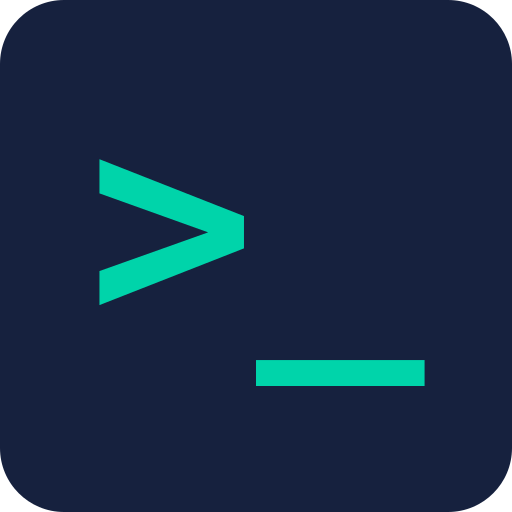

<p align="center">
  
</p>

<h1 align="center">Web Terminal</h1>

<p align="center">
  <b>Your AI coding agents, running on your Windows machine — reachable from any browser or your phone.</b>
</p>

<p align="center">
  
  
  
</p>

---

Start a Claude Code session on your desktop, walk away, and approve its next step from your
phone. Web Terminal keeps the shells alive on the host and gives you a real terminal —
plus a readable chat view of what the agent is actually doing — from anywhere on your
private network.

```bash
git clone https://github.com/Adiel-Sharabi/web-terminal.git
cd web-terminal && npm install && npm start
```

Open **http://localhost:7681** — default login `admin` / `admin`, which it makes you change.
Full instructions: **[docs/INSTALL.md](docs/INSTALL.md)**.

## Why

- **It doesn't stop when you close the tab.** A dedicated worker process owns every PTY, so
  sessions survive server restarts, browser reloads and network drops — with scrollback intact.
- **You find out when it needs you.** Permission prompts raise an urgent alert and can push
  to your phone even with the app closed. No more discovering a blocked agent an hour later.
- **It reads like a conversation, not a screen scrape.** The companion app renders the
  agent's transcript as chat, with proper cards for shell commands, file edits and subagents.
- **It waits out the 5-hour cap for you.** When an agent hits its usage limit it blocks on a
  question ("stop and wait, or upgrade?"). The worker answers *wait*, the row shows when the
  window reopens, and the session picks itself back up a minute after it does — so a limit
  hit overnight costs you the window, not the morning. Only sessions actually observed to be
  capped are resumed, and any row's badge turns it off for that session.
- **One sidebar, every machine.** Run it on several boxes and drive them all from one list.
- **Private by construction.** It binds to localhost; you reach it over your own VPN. Push
  notifications are content-free wake-ups — the text is fetched from your server, not a relay.

## Agent support — read this before choosing

| | Claude Code | Codex |
|---|:---:|:---:|
| Sessions, terminal, chat view, task list, usage badges | ✅ | ✅ |
| Status: waiting / idle | ✅ | ✅ |
| Status: **working** | ✅ | ❌ |
| Subagent drill-in · background-work badge · compaction indicator | ✅ | ❌ |

**Claude Code is fully supported. Codex support is partial and honest about it** — sessions
run and are genuinely usable, but Codex's hooks do not execute (measured, not assumed), so
status rides a narrower channel that has no turn-start signal. A Codex session can never
show *working*. Details and the reasoning: **[docs/AI-AGENTS.md](docs/AI-AGENTS.md)**.

Any other CLI runs fine as a plain shell — it just gets no agent-specific features.

## Highlights

**Sessions** — multiple terminals, instant switching, persistence across restarts, lazy
scrollback, drag-to-reorder, server-side favourites shared by every client (starred from
the session list or from the open session itself), and a one-click recap answering
*"where was I in this one?"*

**Agent integration** — live status dots, task-list panel, rich tool cards, subagent
drill-in, context-window and rate-limit badges, background-work indicator, and read-aloud
that filters out the parts nobody wants spoken.

**Inbox digest** — a waiting session's whole turn is often pages long, so the inbox can ask the
server for a short, model-written briefing of one wait: what the session is about, what exactly
is being asked, and what you need to know to answer (`GET /api/sessions/:id/digest`, advertised
as the `inbox-digest` capability). It is context only: the real question and its options stay
the authority, and nothing it says answers or changes anything. A run happens only when a client
asks (never on a poll), is cached per wait, and is shared by concurrent askers; at most two run
at once. It calls your own `claude -p` login with every tool and setting switched off, from a
scratch folder, and writes in the language of your last prompt. Configure it with an
`inboxDigest` block in `config.json` — `enabled` (default true), `model` (default `sonnet`) and
`command` (the CLI, as a path or `[path, ...args]`; default: `claude.exe` on `PATH`, then
`~/.local/bin`). It is read live and is **not** settable over HTTP, because `command` is
something the server runs.

**Mobile & PWA** — installable, with a compose bar built for soft keyboards, a touch
toolbar, long-press menus, and reconnect the instant you return to the app. When a phone
and a desktop watch the same session, the shared terminal is sized to fit the **smaller**
of them, so a full-width agent screen never arrives on the phone already wrapped — and
backgrounding the phone hands the columns straight back.

**Slash commands from a button** — `/compact`, `/context`, `/usage` and `/clear` are one
tap in either client, instead of a command typed in full into an agent's TUI on a phone.
The button row is **published by the server**, so which commands appear, what they are
called and in what order is one table (`lib/commands.js`) rather than a copy in each
client. Running one lands you where its result actually is: `/compact` stays in the chat
lens with its progress indicator, while `/clear` and the TUI-only panels hold the terminal
lens until you have read them. `/clear` asks first and sorts last — on a phone the first
button is the one a thumb reaches by accident — and no button can fire into an agent that
is still starting.

**Nor can a prompt, in either client.** A new session hands you a compose bar seconds
before its agent has booted, and anything sent in that window reaches the *shell* instead:
it runs as a command, or does nothing, and is gone with no error anywhere. Both the submit
and the live `/`-line now wait for the agent to actually be up — the second matters as much
as the first, because that path streams to the terminal *as you type*, so half a slash
command can end up on bash's command line with the launch command typed onto the same line
after it. Typing is never blocked and your draft is never cleared; the bar says why nothing
was sent, and you press Send again once the agent is up. It is deliberately **not** sent
for you — firing a sentence somebody was still editing is its own way to lose their words.

**A swallowed prompt says so, and gives the words back** — submit while the agent's TUI
is somewhere other than its composer (a full-screen `/usage` view, an open slash menu, a
crashed CLI back at the shell) and the keystrokes are eaten as navigation; until now your
words simply vanished with no error anywhere. The server does not guess at that state
(measured: none of those views emits a distinguishing byte). It **verifies the outcome
instead** — a compose-bar submit that produces no sign of life from the agent is
reported, and the client puts your text back, but only into a compose bar you have not
already started retyping into. Claude sessions on a server whose hooks are installed;
every gate errs toward saying nothing, because a false alarm on a prompt that did land
would be worse than the silence it replaces.

**And a session that is stuck behind a question says which question** — open a session
in a folder Claude has not been trusted with and it parks on a selector before its
composer ever exists. Nothing about that session looks unusual, so you type a prompt and
send it: the keystrokes are taken as navigation and the trailing Enter confirms the
highlighted row, which is **`No, exit`** — the agent is not merely deaf, it is gone, and
your next prompt lands in the shell. The server now recognises that screen by its
*shape* rather than its wording (an unnumbered list with a cursor, a sibling option and
`Enter to confirm`), so siblings like the external-`CLAUDE.md` imports prompt are covered
too. Such a session is never published as able to take a prompt, and the compose bar
stops claiming it is "starting": it quotes the dialog's own options back to you and
points at the Terminal lens. Your draft stays in the box, because nothing was ever sent.
Answering it — or any hook from the agent — clears the block on its own.
Typing the answer *for* you is a separate, opt-in setting
(`autoAnswerBlockingPrompt`, **off** by default: trusting a folder is what decides
whether an agent may execute what is in it).

**Sessions dashboard** — the ▦ button (in the companion app, the dashboard icon on the
Sessions screen) opens every session on every server at once: the
work item(s) each one is on and their state, what it is doing right now, what it just
finished, and what you last asked it, with a **Needs you** strip on top. It is built to
be **true**, not merely filled in: what the hooks prove (the current tool, the last
turn's summary, a commit or a `gh issue close` that touched an item) is shown as fact,
the agent reports only what only it knows (which item, which state), every Claude
session is told how on every prompt, and a turn that changed an item without reporting
it is held for one short report before it ends. A report that has fallen behind says
so on its card. Pin a work item yourself, or switch reporting off for one session.
Every **claude.ai artifact** a session published (an overview page, a plan, a report) is
a link on its card, newest first, and on the closed-sessions list for a week after it ends. It is read
from the publish itself rather than reported, artifacts published before this shipped are
picked up from the session's transcript, and the filter finds a session by an artifact's
title.

A collapsible **Machines** section answers *which machine should I open a new session on?*
For each server it shows its sessions against the session limit (and how many are working
or waiting), CPU load and cores, free memory, free **virtual memory** (commit, which can run
out before memory does), free space on each fixed drive, and uptime. A reading that is low
is amber or red, decided by the server (`lib/machine-profile.js`) so both clients agree. The
drive and virtual-memory figures cost the server a CIM query, so they are read only while
the section is open (`GET /api/machine`, cached for a minute); whether it is open is
remembered per device.

**Background agents** — the agents Claude runs in the background (`claude agents --json`) are listed machine-wide on the server (`GET /api/dashboard/background-agents`): name, project folder, state and what a blocked one is waiting on. Read-only, fetched only when asked and cached for 30 seconds, and a machine without a recent `claude` simply reports it as unavailable.

It is a place to work FROM: your **Favorites** lead it; sessions group by **why they are not
working** (needs you, including a session stuck in a menu, working, running on its own,
blocked on others, idle, done), by server or
by work item; filter by text or machine and choose the order; and **hide** a session that is
not relevant (with an undo) into a Hidden tab, stored on its server so every device agrees.

In the **companion app** the dashboard is a **session board** you can act from: three columns
(**Needs you**, **Working**, **Idle / done**), and on a wide window it fills the main area whenever
no session is open. A question card answers with one press per option, a session waiting on you
takes a one-line reply, **Stop** interrupts a working session, a session stuck in a menu gets Esc,
and **Not waiting** clears a reported wait. **Closed in the last days** keeps a week of closed
sessions, grouped by day, and **Reopen** starts a new session that resumes that conversation on
the same server.

**Why a session is idle** — the session list and the dashboard say why a session that is not
working is not working: it is waiting on you, it will carry on by itself (a CI run, a build, a
usage cap, with how long), it is blocked on someone else, or it is done. Hard signals come
first; what the agent reports at the end of its turn fills in the rest. When an agent
reports it is waiting on you and it is not, **Not waiting** (in the card's menu, beside its
entry in the Needs you strip, where a hidden session shows, or on its row in the session list)
clears it. The session list also has a **filter by title** box.

**Hand off a long session** — a Claude session that has run for days re-reads its whole
context on every turn, and past ~700k tokens it starts losing track of what it already read.
When one is idle, its own report says it is waiting on someone else or done, and its context
has passed the session's hand-off point (below), the companion's board offers **Hand off** on its row. One press makes
the session update its tracker and write a brief for its successor (it posts no GitHub
comment), says whether closing it would lose anything, then starts a fresh session in the same
folder from that brief. The old session closes only once the new one has actually started a
turn and nothing would be lost; otherwise it stays open and the row says why. Every failure
leaves it as it was, and **Cancel** works at every step until the moment it closes. The brief is
written outside the session's folder, so a session that asks before writing files will ask once.

**It also happens on its own.** About once a minute the server hands off, one at a time, any
session the board would offer it for, with no press. The successor is named like the old
session with a number after it, `name (2)`. A **Cancel** or **Dismiss**, or an attempt that ended
kept or failed, stops it trying that session again until you type into it. Every start and every
outcome (closed, kept, failed, cancelled) is appended to `handoffs/handoff-log.jsonl`, with who
started it, the context size, the verdict and the successor, so the automatic hand-offs can be
judged afterwards. The briefs are kept for a week.

Tune it with a `handoff` block in `config.json` (`ctxThreshold`, default: the session's
context budget; `idleMin`, default 10; `auto: false` to go back to the button only;
`enabled: false` for neither), read live. Claude only: another agent is offered nothing.

**See how close a session is to compacting** — Claude compacts where its `autoCompactWindow`
setting says, not at the model's window: at 400k it compacts at about 367k, which is 36% of a
1M window. The server reads that setting from `~/.claude/settings.json` (a change applies within
seconds, no restart) and publishes each session's **context budget** on its metrics: warn at
62.5% of the window (250k at 400k), hand off at 75% (300k), compact at the window minus 33k.
With the setting unset, the model's window is the limit. The companion colours the ctx figure on
the session card and the meta bar against it: green, amber from the warn point, red from the
hand-off point. It also shows how many times the conversation has compacted (`↻3`), counted
from the transcript. An older server publishes no budget and the colour keeps its old % rule.

**Prepare a machine for a restart** — one action, one honest answer.
`node scripts/wt-maintenance.js prepare "Windows update"` (add `--server <url|name>` for a cluster
peer) sets a **restart hold**: every agent session is told, through its own terminal, to bring its
current step to a safe stop and end its turn. A session is told only when it is idle at its
composer: one that is mid-turn, or parked on a permission prompt or a menu, is told once its turn
ends, so the text is never queued behind a turn or answers a question. "Told" means the agent's
own prompt hook carried the text, and "answered" means a turn ended after that. A prompt the agent
visibly did not take is typed again, up to three times. While the hold is
on, new sessions are refused (`503`; pass `"force": true` to override) and no hand-off starts.
`wt-maintenance.js status --wait` reports one verdict per session: `ready`, `working`,
`needs-you`, `busy` (a build or test still running under it), `answering` or `not-told`. It
exits 0 once it is safe to restart. The verdict is decided from state the server already has: the
session's status, what is running under its terminal, and whether its turn ended after it was
told. What the agent wrote is shown alongside but never decides it. The hold clears itself once
the restart has happened, whether the machine rebooted or web-terminal was cold-restarted. The
sessions it had told are then sent a "the machine is back" notice once they are up again.
`wt-maintenance.js cancel` lifts it by hand. Routes: `POST /api/maintenance/prepare`,
`GET /api/maintenance/status`, `DELETE /api/maintenance`.

**Helper sessions don't pile up** — an agent that starts a session with `POST /api/sessions`
(often on another machine) and never closes it used to hold one of the machine's session slots
for as long as it lived. Now a session nobody opens within two minutes of creating it counts as
agent-started (a person opens the session they just made; an agent's API call never does, so
this does not depend on how the caller logged in), and once its turn has ended and nobody has
looked at it or touched it for `spawnedSessionIdleCloseHours` (default 6, `0` turns it off; only a
number is accepted, anything else is the default; read
live from `config.json`) the server closes it and logs a `spawn-reaper: closed` line. A session
that is running, waiting on you, compacting, running a background command, favourited, or held
by a usage limit is never closed, nor is one whose state the server could not read (it keeps it
rather than guess), and neither is any session the server did not see created (restored after a
restart, or made another way). The successor of an agent-started session handed off to a fresh one
is agent-started too. A caller can pass `spawnedBy` (a short label)
when it creates a session; session rows carry `spawn: { by, spawnedBy, createdAt, parentId }`.

**Helper sessions show as children** — a session that opens another passes its own id as
`parentId` on `POST /api/sessions` (inside a web-terminal session that is `$WT_SESSION_ID`; the
parent may be on another machine, and a malformed id is refused with 400). In the companion's
session list the helper sits under its parent, indented; one whose parent is on another machine
stays in its own machine's group, and its family line (below) names the parent. On the dashboard a helper sits under its parent
within a column, says who opened it, and the parent's card lists the sessions it opened with
their status, each one tap away. A hand-off keeps the tree at both ends: a helper's successor
stays under the same parent, and a parent's successor publishes `spawn.replaces` (the ids it took
the place of), so helpers that still name the old id, on any machine, find their parent.
A script that sends only `spawnedBy` (no `parentId`) is traced instead: when the request comes from
this machine, the server follows the calling process up to the session it runs in and records that
as the parent.
In the session list, a session with sub-sessions in its own machine's group has a line under it (`N sub-sessions`, counting
every level below it): tap it to fold them away and again to bring them back. Folded, the line keeps one
status dot per hidden session, so a helper waiting on you still shows; the choice is remembered
on the device.
A run often spans machines (a lead on one box opens workers on two others), which the per-machine
groups cut apart, so every card with relatives on any machine has a **family line**:
`↑ <parent> · <machine>   ↓ N sub-sessions` (the machine only when it is another one). Tap it
for the whole family: the tree from its top-most session down, on every machine, with live status
dots and the session you came from marked; tap a row to open that session. Inside a session, a strip
under the title lists its ancestors, each one tap away, and opens the same family view.

**A colour per machine** — set `serverColor` on each server and its sessions carry that colour
in the session list and on the dashboard of every client.

**Cluster** — merge several servers into one sidebar, each showing its own CPU and
**free memory** so you can pick where to work; optional direct-terminal mode skips the
proxy hop for a large latency win.

**Headroom, not percentages** — the memory readout leads with the room actually left
(*"12.7G free of 31.7G"*), keeping the percentage as context, and colours on the
absolute figure. A percentage saturates exactly where the choice matters: 92% and 98%
are six points apart while the room underneath goes 2.5 GB to 0.65 GB — the difference
between a box that copes and one that is unusable. A server too old to report it falls
back to the percentage rather than showing a fabricated zero.

**Load view** — switch it on (the chart button in the web sidebar, the memory button in
the companion) and every server reports its **paging rate** (hard page reads per second,
the signal that tells 92%-and-coping apart from 92%-and-thrashing), what web-terminal
itself is costing there, and what each individual session is costing — so "which box,
which session" is answered from the list instead of by guessing. It is off by default
and polls nothing until switched on, because each reading costs the server a
whole-machine process query. The CPU/free-memory figure above costs the server nothing
and is always *reported*, and **both clients** show it whether or not the load view is
on — see [docs/CLUSTER.md](docs/CLUSTER.md#server-load-152) for how the companion gets it
for free too.

**Which device did the work** — every prompt is logged with the device that sent it
(phone, tablet or a desktop, told apart by its tailnet address; never the prompt text),
and `scripts/device-ops-report.js` turns a week of it into operations and active hours
per device, in and out of office hours.

**Companion app** — a native Android + Windows client with the chat lens and push that
works while the app is closed.

Full list: **[docs/FEATURES.md](docs/FEATURES.md)**.

## Documentation

| | |
|---|---|
| **[docs/INSTALL.md](docs/INSTALL.md)** | Install, auto-start, remote access, updating |
| **[docs/CONFIGURATION.md](docs/CONFIGURATION.md)** | Every setting and environment variable |
| **[docs/AI-AGENTS.md](docs/AI-AGENTS.md)** | Claude vs Codex support, hooks setup |
| **[docs/FEATURES.md](docs/FEATURES.md)** | The complete feature reference |
| **[docs/CLUSTER.md](docs/CLUSTER.md)** | Multi-server setup and direct terminal mode |
| **[docs/COMPANION.md](docs/COMPANION.md)** | The Android + Windows companion app |
| **[docs/TROUBLESHOOTING.md](docs/TROUBLESHOOTING.md)** | Known symptoms and dev tooling |
| **[docs/ARCHITECTURE.md](docs/ARCHITECTURE.md)** | How the three-process design works |
| **[AGENTS.md](AGENTS.md)** | Point an AI agent at this repo and it can install and operate it |
| **[CONTRIBUTING.md](CONTRIBUTING.md)** | Dev setup and the PR gate |
| **[SECURITY.md](SECURITY.md)** | Threat model and vulnerability reporting |

## How it works

Three supervised Node processes. `monitor.js` supervises the other two and restarts them on
crash. **`pty-worker.js` owns every PTY** — which is why killing the web layer costs you
nothing. `server.js` is stateless with respect to sessions and talks to the worker over an
authenticated local pipe.

```
Phone / Tablet ──┐
                 ├──> VPN ──> server.js ──(IPC)──> pty-worker.js ──> shell ──> agent
PC Browser ──────┘                │
                                  └──> other servers (cluster proxy)
```

That split is the reason a `server.js` restart keeps your sessions running — see
[docs/ARCHITECTURE.md](docs/ARCHITECTURE.md).

## Platform

**Windows-first by design**, where browser-based terminals are scarce. On Linux or macOS
you probably want [ttyd](https://github.com/tsl0922/ttyd),
[gotty](https://github.com/sorenisanerd/gotty) or
[code-server](https://github.com/coder/code-server) instead.

Requires [Node.js](https://nodejs.org) 18+ and [Git for Windows](https://git-scm.com/download/win).

## License

MIT — see [LICENSE](LICENSE).
